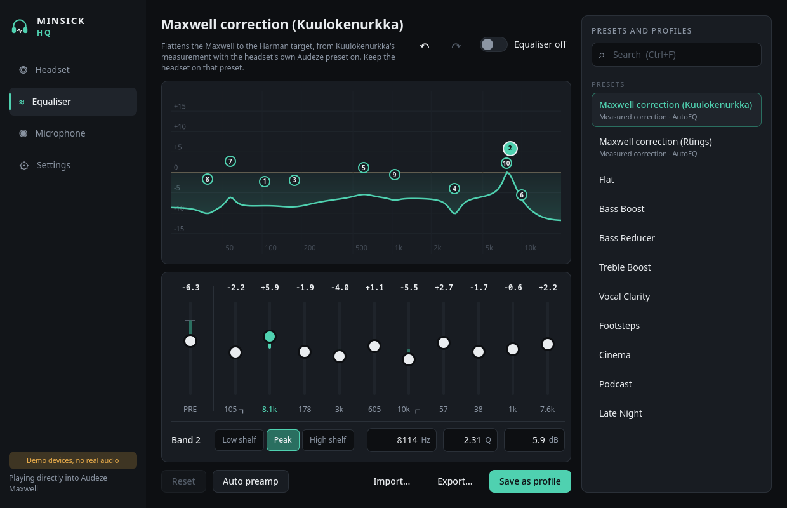

# Minsick HQ

A Linux companion app for headphones, made with the Audeze Maxwell in mind and written from
scratch: the headset's status and outputs, and a 10-band parametric equaliser that runs on real
system audio through PipeWire. It works with any output PipeWire knows about.

> Minsick HQ is an independent project, not affiliated with or endorsed by Audeze LLC. Audeze,
> Maxwell and Audeze HQ are trademarks of Audeze LLC. See [NOTICE.md](NOTICE.md).



## Run it

```bash
./minsick-hq            # the app
./minsick-hq --demo     # sample devices, no real audio: try it without the headset
python3 -m unittest discover -s tests -t .   # the tests
```

Needs Python 3.11+, PySide6 6.5+ and PipeWire with WirePlumber (`pw-dump`, `pw-cli`, `wpctl`).
On Arch: `sudo pacman -S pyside6 pipewire wireplumber`.

To get it in your app launcher, run this from the project folder (it fills in where the project is):

```bash
sed "s|@DIR@|$PWD|g" packaging/minsick-hq.desktop.in > ~/.local/share/applications/minsick-hq.desktop
```

## What it does

- **Headset.** Notices the Maxwell on its USB dongle or over Bluetooth within a couple of seconds
  of plugging it in. Lists every output, and makes one the system default.
- **Equaliser.** Ten fully parametric bands plus a preamp. Drag the numbered points on the graph
  (sideways for frequency, up and down for gain, scroll for width), or pick a band and type its
  type, frequency, width and gain. The curve turns orange where it would clip; *Auto preamp*
  lowers the preamp until it can't. Undo and redo cover every change (Ctrl+Z, Ctrl+Shift+Z).
- **Maxwell corrections.** Two measured corrections from the AutoEQ project flatten the Maxwell
  toward the Harman target: Kuulokenurkka's (gentle; keep the headset on its own Audeze preset)
  and Rtings' (big bass changes).
- **Presets and profiles.** Nine simple presets, the corrections, and your own profiles in
  `~/.config/minsick-hq/profiles.json`. **Search** (Ctrl+F) filters them all. Profiles can be
  renamed, deleted, and imported or exported as AutoEQ `ParametricEQ.txt` files, which other EQ
  apps read too.
- **Microphone.** Cleans up the headset's mic with PipeWire's WebRTC processing: background noise,
  uneven level, low rumble and echo. Apps pick "Minsick HQ Microphone", or it becomes the default.
- **Runs in the background.** Closing the window leaves the equaliser and microphone working
  (Settings can turn that off); opening Minsick HQ again brings the window back. It can start at
  login, hidden, through a systemd user service. Where the desktop has a tray, it shows an icon
  with the main switches.
- **Dialogs** queue up and show one at a time.

Shortcuts: Ctrl+1 to 4 pages, Ctrl+F search, Ctrl+E equaliser, Ctrl+M microphone, Ctrl+Z undo.

## How the equaliser and microphone work

Switching the equaliser on starts a small PipeWire process of the app's own (`pipewire -c` with a
generated filter-chain config). It adds an output called *Minsick HQ Equalizer*, makes that the
default, and sends its sound through the preamp and ten biquad filters into the headset. Moving a
band updates the running filters with `pw-cli set-param`, so the audio never restarts; only
changing a band's type rebuilds the filter.

The microphone works the same way with PipeWire's echo-cancel module and its WebRTC engine,
listening to the headset's mic and offering *Minsick HQ Microphone*.

Switching either off, or quitting, stops its process: what it added disappears and your previous
default output or microphone comes back. The app never writes to PipeWire's own configuration.

The equaliser always plays into a named output, never into "the default", because once it *is*
the default it would feed into itself.

## Headset controls

Battery, sidetone and the headset's own settings need the Maxwell's control protocol, which is
being worked out from our own device: see [docs/headset-protocol.md](docs/headset-protocol.md).
`python3 -m minsick_hq.hid.listen` logs what the headset reports by itself, read-only.

## Background

Audeze's official app runs only on Windows and macOS; Minsick HQ is an independent take on the
same kind of companion app for Linux, written from scratch.

## Layout

```
minsick_hq/
  eq/biquad.py         filter maths for the curve (Audio EQ Cookbook)
  eq/presets.py        settings, bands and the simple presets
  eq/autoeq.py         AutoEQ ParametricEQ.txt, read and written
  eq/corrections/      the Maxwell corrections from AutoEQ, with its licence
  eq/engine.py         the equaliser's PipeWire filter-chain and live updates
  mic.py               the cleaned microphone (PipeWire echo-cancel, WebRTC)
  pwproc.py            the small PipeWire processes both of those run in
  audio/pipewire.py    outputs, microphones and defaults, from pw-dump and wpctl
  profiles.py          saved profiles, settings and search
  autostart.py         start at login (systemd user service)
  hid/                 the dongle's control interface: finding it, listening read-only
  bridge.py            what the QML talks to; everything slow runs through QProcess
  app.py               start-up, one copy at a time, background mode, the tray
  qml/                 Main.qml, the four pages, and the Ms component library
packaging/             the launcher entry template, and the udev rule for systems that need it
docs/                  screenshots and the headset protocol notes
tests/                 the backend without Qt, and the bridge in demo mode
```

## Licence

MIT, see [LICENSE](LICENSE). Third-party software and trademarks are listed in
[NOTICE.md](NOTICE.md).
